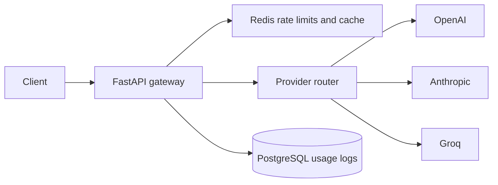

# LLM Inference Gateway

An OpenAI-compatible gateway for sending chat-completion requests to multiple model providers through one API. The project focuses on the infrastructure around inference: routing, streaming normalization, rate limits, caching, fallbacks, and usage visibility.

**Stack:** FastAPI · Redis · PostgreSQL

[4-minute walkthrough](https://www.loom.com/share/8916ae03dfa345b683c4e235d31c3eea) · [Architecture notes](docs/architecture.md)

## What it demonstrates

- OpenAI-compatible `/v1/chat/completions` endpoint
- Provider selection for OpenAI, Anthropic, and Groq
- Streaming responses normalized to the OpenAI SSE format
- Redis sliding-window request and token limits
- Exact-match response caching for non-streaming requests
- Retry and provider fallback handling for timeouts and upstream failures
- PostgreSQL request logging and usage analytics
- Synthetic failure injection for local reliability experiments

## Request flow



## Run locally

Requirements: Python, Docker, and Docker Compose.

```bash
python3 -m venv .venv
source .venv/bin/activate
pip install -r requirements.txt
docker compose up -d
uvicorn app.main:app --reload
```

The API is available at `http://localhost:8000`. Interactive API documentation is available at `/docs`.

## Authentication and provider keys

The sample configuration uses a gateway bearer token (default demo key: `demo-key`). Supply an upstream provider and key either in the JSON request or with `X-Provider` and `X-Provider-Api-Key` headers. Use environment variables for real credentials; never commit API keys.

Example request:

```bash
curl http://localhost:8000/v1/chat/completions \
  -H "Authorization: Bearer demo-key" \
  -H "X-Provider: groq" \
  -H "X-Provider-Api-Key: $GROQ_API_KEY" \
  -H "Content-Type: application/json" \
  -d '{"model":"llama-3.1-8b-instant","messages":[{"role":"user","content":"Hello"}]}'
```

## Reliability experiments

The repository includes synthetic provider failure and timeout settings, plus load-test scripts and benchmark notes in `scripts/` and `docs/benchmarks.md`. Measurements are local experiments against a Dockerized stack; they are not production SLOs or guarantees.

## Design notes

- Pydantic v2 models define request and response contracts.
- A shared async `httpx` client is initialized with the FastAPI lifespan.
- Streaming responses use FastAPI `StreamingResponse`.
- Provider adapters share an async interface so routing behavior stays provider-agnostic.

## Scope and tradeoffs

- Cache matching is exact; semantic cache behavior is explored separately in [semantic-cache-system](https://github.com/rahuljtom/semantic-cache-system).
- Streaming follows the OpenAI SSE shape and may omit provider-specific metadata.
- Fallback can return a different model's output.
- Rate limiting uses a single Redis deployment and is not a multi-region coordination system.
- Model pricing comes from static tables and may need updates as providers change pricing.
